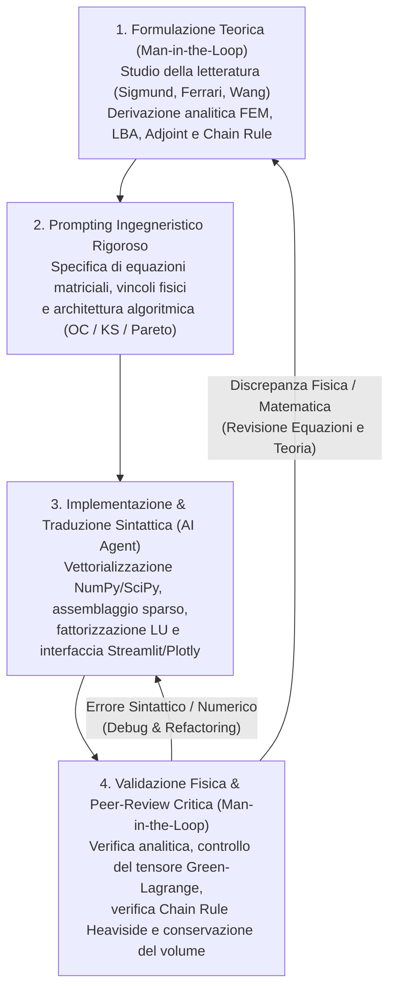

# 2D Continuum SIMP Topology Optimization with Linearized Buckling Analysis (LBA)

Un motore scientifico di **Ottimizzazione Topologica 2D nel continuo** basato sul metodo **SIMP a tre campi** (*Design $\to$ Density Filter $\to$ Heaviside Projection*) accoppiato ad **Analisi di Buckling Linearizzato (LBA)**, aggregazione multimodale di **Kreisselmeier-Steinhauser (KS)** e scalarizzazione multi-obiettivo di Pareto, dotato di interfaccia interattiva **Streamlit**.

---

## Caratteristiche Principali e Implementazioni Fisiche

- ** Solutore FEM Q4 Plane Stress Vettorializzato (`physics_engine/simp_engine_2d.py`)**:
  - Elementi quadrilateri bilineari isoparametrici a 4 nodi (Q4) con integrazione di Gauss $2 \times 2$ pre-calcolata ($\mathbf{k}_0$).
  - Assemblaggio sparso veloce (`scipy.sparse.csc_matrix`) e **fattorizzazione LU sparsa riusabile** (`scipy.sparse.linalg.factorized`), calcolata una sola volta per iterazione e condivisa tra l'equilibrio elastico e tutti gli $n_{\text{eig}}$ sistemi aggiunti.
- ** Formulazione SIMP a Tre Campi & Chain Rule Esatta**:
  - Filtro spaziale conico sulle densità ($\tilde{\mathbf{x}} = \mathbf{H}\mathbf{x} / \mathbf{H}_s$) seguito da proiezione regolarizzata di **Heaviside** ($\hat{\mathbf{p}}$) con continuazione automatica del parametro di nitidezza $\beta$.
  - Applicazione rigorosa della **Regola della Catena (Chain Rule)** sia sul gradiente dell'obiettivo ($\partial F / \partial x_e$) sia sul gradiente del volume ($\partial V / \partial x_e$).
  - Ciclo di bisezione **Optimality Criteria (OC)** con verifica esatta del vincolo sul **volume fisico proiettato** $\hat{\mathbf{p}}(\tilde{\mathbf{x}}(\mathbf{x}_{\text{new}}))$ ad ogni sotto-iterazione.
- ** Analisi di Buckling Linearizzato (LBA) & Aggregazione KS**:
  - Matrice di rigidezza geometrica $\mathbf{G}(\hat{\mathbf{p}}, \mathbf{u})$ derivata rigorosamente dal tensore di deformazione non lineare di **Green-Lagrange** ($u_{,x}^2 + v_{,x}^2$) mediante matrici binarie baricentriche pre-calcolate ($\mathbf{T}_x, \mathbf{T}_y, \mathbf{T}_{xy}$).
  - Penalizzazione differenziata ($E_K$ con $E_{\min}=10^{-9}$, $E_G = E_0 \hat{p}_e^3$) per sopprimere i modi spuri nelle regioni di vuoto.
  - Scelta da interfaccia tra **Modo Fondamentale ($n_{\text{eig}}=1$, Weighted Sum)** e **Aggregatore Multimodale di Kreisselmeier-Steinhauser ($n_{\text{eig}}>1$, KS Aggregator)** per prevenire l'instabilità numerica da *mode-switching* negli autovalori ravvicinati.
- ** Frontiera di Pareto & Post-Processing Scientifico (`app.py`)**:
  - Trade-off continuo $\alpha \in [0, 0.90]$ tra cedevolezza elastica ($C$) e stabilità a carico di punta ($\text{BLF} = \lambda_1$) con normalizzazione dinamica $L_1$ dei gradienti ad ogni iterazione.
  - Generazione automatica a posteriori della **Frontiera di Pareto** ($\alpha \in [0.0, 1.0]$) con rendering *smooth* dei contorni strutturali.
  - Mappe delle tensioni principali minime ($\sigma_{II}$) mascherate sul solido con scala cromatica accademica **`Jet_r`** (**Rosso** = Compressione / rischio buckling, **Blu** = Trazione).

---

## Workflow di Sviluppo: Paradigma "Man-in-the-Loop" (Vibe Coding Scientifico)

Il codice è stato sviluppato adottando una rigorosa metodologia **Human-in-the-Loop (Man-in-the-Loop)**, in cui la direzione teorica, matematica e di validazione fisica risiede interamente nel ricercatore umano, mentre l'agente IA opera esclusivamente come traduttore sintattico e implementatore numerico.



### Ruoli nel Ciclo Man-in-the-Loop
1. **Ricercatore Umano (Controllo Teorico e Validazione)**:
   - Selezione critica della letteratura scientifica (*Ferrari et al., 2021*; *Marler & Arora, 2004*; *Wang et al., 2011*).
   - Formulazione matematica delle derivate aggiunte per il buckling, della normalizzazione dinamica multi-obiettivo e della regola della catena sul filtro di Heaviside.
   - Revisione critica riga per riga del codice generato (es. correzione del tensore geometrico di Green-Lagrange $u_{,x}^2 + v_{,x}^2$ e imposizione del controllo sul volume fisico $\hat{\mathbf{p}}$ nel ciclo di bisezione OC).
2. **Agente IA (Esecuzione Software e Vettorializzazione)**:
   - Traduzione delle equazioni matriciali in codice Python vettorializzato (`numpy.einsum`, `scipy.sparse`).
   - Ottimizzazione dei colli di bottiglia computazionali (pre-fattorizzazione `sla.factorized(K_free)` per i vettori aggiunti).
   - Realizzazione della dashboard interattiva Streamlit e della suite di test automatizzati (`pytest`).

---

## Struttura della Repository

```text
├── app.py                          # Dashboard interattiva Streamlit (SIMP 2D, LBA, KS, Pareto Sweep)
├── Documentation.md                # Documentazione teorica completa con tutte le equazioni implementate
├── Documentation.tex               # Versione LaTeX della documentazione teorica
├── AGENTS.md                       # Standard operativi e regole fisiche/numeriche del progetto
├── requirements.txt                # Dipendenze Python
├── physics_engine/
│   ├── simp_engine_2d.py           # Motore FEM Q4 + SIMP 3-campi + Buckling LBA + KS Aggregator
│   ├── ground_structure.py         # Solutore reticolare discreto (Ground Structure Method via LP)
│   └── __init__.py
└── tests/
    ├── test_simp_engine.py         # Unit test su matrici di rigidezza, convergenza OC e volume fisico
    └── test_case_study_ground_structure.py
```

---

## Avvio Rapido

1. **Installazione dipendenze**:
   ```bash
   pip install -r requirements.txt
   ```
2. **Avvio della Dashboard interattiva**:
   ```bash
   python -m streamlit run app.py
   ```
3. **Esecuzione dei test di validazione**:
   ```bash
   pytest tests/test_simp_engine.py
   ```
