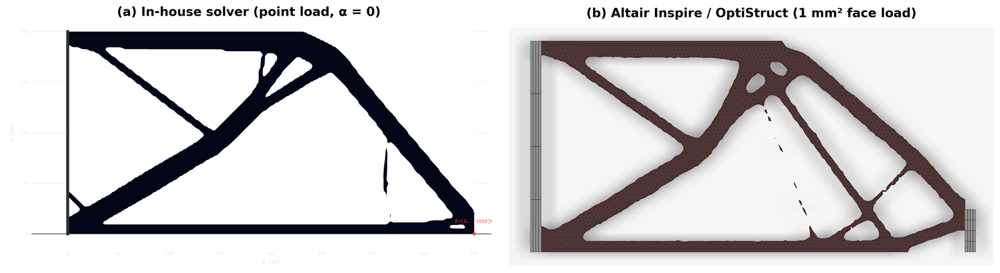
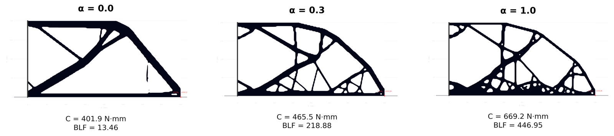
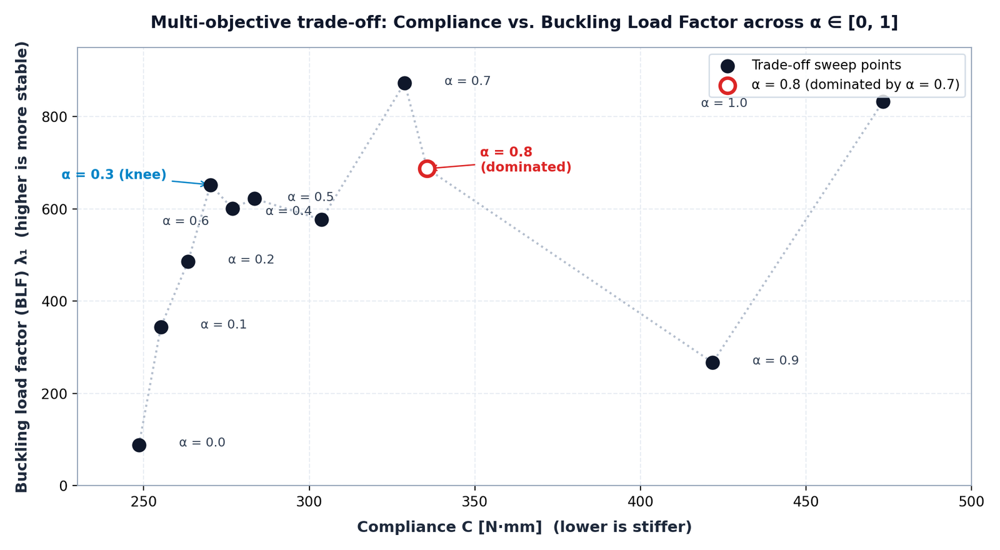

# 2D topology optimization with linearized buckling analysis

2D continuum topology optimization solver based on the SIMP method, with linearized buckling analysis and Kreisselmeier-Steinhauser multi-modal aggregation. Includes an interactive Streamlit dashboard.

> **Work in progress.** The FE core and the compliance-only case have been checked against external references (see [Results](#results)). The buckling sensitivities are not yet validated against commercial software or a reference code.

## Status
 
| Component | State |
|---|---|
| Q4 plane-stress FE core | Verified: full-solid cantilever within 1% of Timoshenko beam theory |
| Compliance-only optimization (α = 0) | Compared with Altair Inspire (OptiStruct): +5.6% compliance, main load paths consistent |
| Buckling sensitivities, KS aggregation, α sweep | Implemented; not yet validated against commercial software |
| Pareto front | Not yet implemented, see [Next](#next) |
| 3D version | check TO3D repo |

## Results
 
All results: 400 × 200 mm cantilever (200 × 100 elements of 2 mm), left edge fixed, point load F = 1000 N downward at (400, 0), volume fraction 25%, Al 6061-T6, thickness 5 mm, SIMP p = 3, filter radius 5 mm (2.5 elements), 100 iterations. Compliance is reported in physical units (N·mm).

### Comparison with Inspire (compliance-only, α = 0)
  
- Same design domain, fixed edge and volume fraction. In Inspire the load is applied on a face of a non-design block outside the design space.
- Main load paths agree; secondary members differ (the problem is non-convex and the algorithms differ: density filter + Heaviside projection + OC here, OptiStruct in Inspire).
- Differences between the two models: plane-stress Q4 elements vs. 3D tetrahedra (extruded 5 mm), point load vs. face load.
- Inspire's topology solver has no buckling objective, so only α = 0 can be compared. This comparison does not validate the buckling part.


*Fig. 1: Compliance-only topology, 400×200 mm domain, fixed left edge, F = 1000 N, V_f = 25%: in-house solver, point load (left) vs. Altair Inspire/OptiStruct, face load (right).*

### α sweep (compliance–buckling trade-off)
 
α weights the buckling term. The effective weight is capped at 0.65 (see the documentation), so α = 0 is compliance-only (the BLF is computed a posteriori, not optimized) and α = 1 is **not** buckling-only. KS aggregation of 4 modes (ρ_KS = 20).
 

*Fig. 2: Designs for α = 0, 0.3 and 1.0, with compliance C and BLF. α = 0 is compliance-only; α = 1 is not buckling-only (effective weight capped at 0.65).*


*Fig. 3: C–BLF values for the 11 sweep points; the hollow marker (α = 0.8) is dominated by α = 0.7.*
 
| α | C [N·mm] | BLF (in-plane) | Note |
|---|---|---|---|
| 0.0 | 401.9 | 13.46 | compliance-only |
| 0.1 | 420.5 | 67.36 | |
| 0.2 | 438.9 | 131.12 | |
| 0.3 | 465.5 | 218.88 | +15.8% C, ×16.3 BLF vs. α = 0 |
| 0.4 | 487.9 | 274.87 | |
| 0.5 | 507.2 | 297.30 | |
| 0.6 | 533.1 | 333.87 | |
| 0.7 | 560.6 | 374.22 | |
| 0.8 | 581.0 | 365.61 | dominated by α = 0.7 |
| 0.9 | 604.9 | 399.57 | |
| 1.0 | 669.2 | 446.95 | +66.5% C, ×33.2 BLF vs. α = 0 |
 
- 10 of 11 designs are non-dominated. α = 0.8 is dominated by α = 0.7 (higher compliance and lower BLF), consistent with a local minimum of a non-convex problem solved with a local optimizer.
- The knee is between α = 0.3 and 0.4; beyond that the BLF gained per unit of compliance roughly halves.
- BLF values are in-plane model quantities, not safety margins: for slender members, out-of-plane buckling would occur at lower loads.
- The sweep is a scan of trade-offs, not a guaranteed Pareto front since the normalization is recomputed at every iteration and the effective weight is ramped and capped.

## Implemented features

- Vectorized Q4 plane stress FEM (`physics_engine/simp_engine_2d.py`):
  - 4-node bilinear quadrilateral elements with pre-computed 2x2 Gauss stiffness matrix ($k_0$).
  - Sparse CSC assembly (`scipy.sparse.csc_matrix`) and reusable sparse LU factorization (`scipy.sparse.linalg.factorized`), computed once per iteration and shared across static equilibrium, shift-invert Arnoldi iterations, and adjoint solves.
- Three-field SIMP and exact chain rule:
  - Cone density filter ($\tilde{x} = Hx / H_s$) followed by a smoothed Heaviside projection ($x_{\text{Phys}}$) with automatic $\beta$-continuation.
  - Full chain rule applied to both objective sensitivities ($\partial f / \partial x_e$) and volume sensitivities ($\partial V / \partial x_e$).
  - Optimality criteria (OC) bisection loop evaluating the true projected physical volume at every sub-iteration, with support for passive solid and void regions.
- LBA and KS aggregation:
  - Geometric stiffness matrix $K_G(x_{\text{Phys}}, u)$ assembled from the non-linear Green-Lagrange strain tensor ($u_{,x}^2 + v_{,x}^2$) using pre-computed centroidal matrices ($T_x, T_y, T_{xy}$).
  - Differential penalization ($p_G = 6 > p_K = 3$ and zero geometric stiffness in void regions) to suppress spurious buckling modes in low-density elements.
  - Option to optimize either the fundamental mode ($n_{\text{eig}} = 1$) or the Kreisselmeier-Steinhauser (KS) multi-modal aggregate ($n_{\text{eig}} > 1$) to avoid mode switching when eigenvalues coalesce.
- Buckling-compliance trade-off and post-processing (`app.py`):
  - Continuous weighting $\alpha$ between compliance ($C$) and critical buckling load factor ($\text{BLF} = \lambda_1$) using dynamic $L_1$ gradient normalization.
  - Sweeping $\alpha \in [0, 1]$.
  - Dual-view visualization: black-and-white structural layout alongside a void-masked minimum principal stress ($\sigma_{II}$) map (`Jet_r` colormap: red for compression, blue for tension).

## Man-in-the-loop development workflow

This repository was developed with a human-in-the-loop approach: mathematical formulation, literature selection, and physical validation are handled by the engineer, while the AI agent is used strictly for code translation, vectorization, and UI wiring.

```text
[1. Theoretical formulation (human)]
   Literature review
   Analytical derivation of FEM, LBA, etc...
        |
        v
[2. Engineering specification (human)]
   Definition of matrix equations, boundary conditions, and algorithmic structure
        |
        v
[3. Code implementation & vectorization (Agents)]
   Translation into vectorized NumPy/SciPy routines and Streamlit UI
        |
        v
[4. Physical validation & code review (human)]
   Verification against closed-form benchmarks, Green-Lagrange tensor check,
   chain-rule consistency check, and exact physical volume conservation in OC
        |
        +---> Numerical or syntax bug ----------> back to [3. Code implementation (AI)]
        +---> Physical or mathematical issue ---> back to [1. Theoretical formulation (human)]
```

## Validation tests and changelog
 
Cross-checking the solver against external references (Altair Inspire on a 400 × 200 × 5 mm Al 6061-T6 cantilever, and closed-form Timoshenko beam theory) identified two hardcoded UI parameters, a latent E₀² scaling bug and an unconverged continuation step. All are fixed.
 
**Automated tests** (`pytest tests/`, `tests/test_simp_engine.py`):
 
1. Frozen-settings regression: 200 × 100 cantilever (E₀ = 68900 MPa, t = 5 mm, 45 iterations, legacy β schedule) reproduces C = 392.0 N·mm (30 mm strip load, ν = 0.33) and C = 418.01 N·mm (point load, ν = 0.30). These are regression reference values for the legacy settings, not validation results.
2. *Scale invariance:* (E₀ = 1, t = 10) vs. (E₀ = 68900, t = 5) give identical C·E₀·t, identical BLF/(E₀·t) and identical topology.
3. *Full solid vs. Timoshenko beam:* the full-solid Q4 cantilever matches the analytical compliance C = F²L³/(3E₀I) + 6F²L/(5GA) = 111.42 N·mm within 1%.

**Changelog**
 
- Fixed a double-E₀ scaling bug in `physics_engine/simp_engine_2d.py`: `_build_element_stiffness()` (`k0`) and `_init_buckling_matrices()` (`Cmat0`) multiplied by `self.E0` at initialization, and `solve()` multiplied again by `E_elements` and `E_G`, so the stiffness scaled as E₀² whenever E₀ ≠ 1. Base matrices are now assembled at unit modulus, with dimensionless void ratio E_min/E₀ = 10⁻⁹.
- Exposed physical parameters in the UI (`app.py`): the hardcoded E₀ = 1.0 MPa, thickness = 10 mm, ν = 0.30 and `max_iter = 45` were replaced by explicit inputs defaulting to Al 6061-T6 (E₀ = 68900 MPa, ν = 0.33, t = 5 mm, `max_iter = 100`).
- β-continuation, OC damping and stopping criterion: β no longer jumps on the final iteration without equilibration, OC damping and a tighter move limit were added at high β to remove boundary flip-flopping, and an early stop on relative objective stability over a 10-iteration window (evaluated at maximum β) was implemented. The status message reports "converged after N iterations" only when the criterion is met, and "stopped after N iterations" when `max_iter` is reached otherwise.
- Filter radius note: r_min is specified in mm. With r_min = 2.5 mm on a 2 mm mesh (1.25 elements) the filtering is minimal and mesh-scale fragments appear. Mesh independence requires r_min ≈ 2.5–3 element lengths (5–6 mm here).

## Limitations
 
- Buckling is in-plane only (2D). Out-of-plane buckling of slender members is not captured.
- Buckling sensitivities and KS aggregation are not validated against commercial software or a reference code.
- BLF values are model quantities, not safety margins.
- Thin members and holes at the scale of one or two elements (mostly for α ≥ 0.6) are mesh-scale features, where Q4 elements overestimate bending stiffness.
- The compliance comparison with Inspire comes from a run that stopped at the iteration limit, and compares different element formulations and load applications.
- The α sweep does not guarantee Pareto optimality.

## Next
 
- Approximate Pareto front: fixed normalization (utopia/nadir from reference runs), non-dominated filtering and a comparison of n_eig = 1 vs. KS.
- Independent buckling check on fixed designs: Inspire linear buckling and a literature benchmark (Ferrari–Sigmund–Guest).
- Convergence study (iteration count, filter radius).

## Repository structure

```text
├── app.py                          # Streamlit dashboard (2D SIMP, LBA, KS, Pareto sweep)
├── Documentation.md                # Theoretical documentation with all implemented equations
├── Documentation.tex               # LaTeX source of the theoretical documentation
├── AGENTS.md                       # Project rules and numerical standards
├── requirements.txt                # Python dependencies
├── docs/                           # Theoretical documentation and high-resolution figures
│   ├── Documentation.pdf
│   └── figures/
│       ├── validation_inspire.png
│       ├── alpha_sweep.png
│       └── c_blf_tradeoff.png
├── physics_engine/
│   ├── simp_engine_2d.py           # Q4 FEM + 3-field SIMP + LBA + KS aggregator
│   ├── ground_structure.py         # Discrete truss ground structure solver
│   └── __init__.py
└── tests/
    ├── test_simp_engine.py         # Unit, regression, scale-invariance, and Timoshenko tests
    └── test_case_study_ground_structure.py
```

## Quick start

Install dependencies:
```bash
pip install -r requirements.txt
```

Run the interactive dashboard:
```bash
python -m streamlit run app.py
```

Run validation tests:
```bash
pytest tests/
```

## References
 
1. F. Ferrari, O. Sigmund, J. K. Guest, "Topology optimization with linearized buckling criteria in 250 lines of Matlab", *Struct. Multidisc. Optim.* 63, 3045–3066 (2021). DOI: 10.1007/s00158-021-02854-x
2. F. Ferrari, O. Sigmund, "Revisiting topology optimization with buckling constraints", *Struct. Multidisc. Optim.* 61(4), 1401–1415 (2020).
3. O. Sigmund, "A 99 line topology optimization code written in Matlab", *Struct. Multidisc. Optim.* 21(2), 120–127 (2001).
4. F. Wang, B. Lazarov, O. Sigmund, "On projection methods, convergence and robust formulations in topology optimization", *Struct. Multidisc. Optim.* 43(6), 767–784 (2011).

## License
 
[MIT — add a `LICENSE` file]
